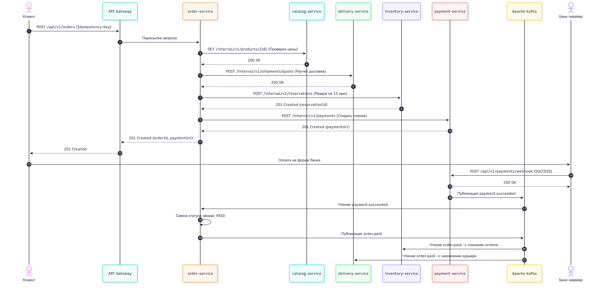
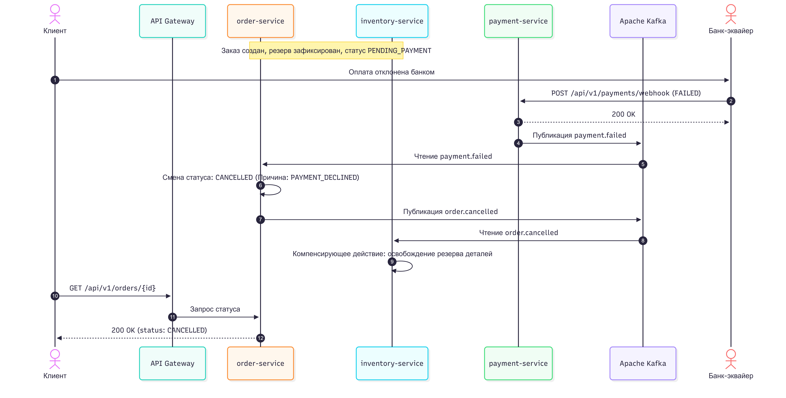

# Лабораторная работа №3. Декомпозиция и проектирование микросервисной системы «PartsFlow»

## 1. Анализ предметной области

### Описание системы
Платформа **«PartsFlow»** — это специализированный B2C-маркетплейс для подбора, заказа и экспресс-доставки автомобильных запчастей и расходных материалов. Система позволяет автовладельцам искать оригинальные детали и сертифицированные аналоги по VIN-коду и OEM-артикулам, резервировать остатки на распределенных складах, оплачивать заказы онлайн и отслеживать курьерскую доставку. Платформа решает проблему несовместимости запчастей за счет встроенной базы применимости к модификациям автомобилей и гарантирует сохранность товара за покупателем на время оплаты.

### Акторы системы
* **Покупатель (Client):** Ищет автозапчасти в каталоге, проверяет совместимость с автомобилем, оформляет и оплачивает заказ, отслеживает доставку.
* **Администратор каталога (Catalog Manager):** Управляет номенклатурой деталей, таблицами кросс-номеров (аналогов) и справочниками применимости.
* **Кладовщик (Warehouse Operator):** Комплектует оплаченные заказы на складе и передает их в службу доставки.
* **Курьер (Courier):** Принимает скомплектованные заказы со склада, доставляет их покупателю и обновляет статусы вручения.
* **Платёжный шлюз (External Payment Gateway):** Внешняя банковская система эквайринга, которая проводит транзакции по картам и присылает уведомления (webhooks) о результате оплаты.
* **Шлюз уведомлений (SMS/Push Provider):** Внешний сервис для отправки сервисных сообщений и чеков клиентам.

### Пользовательские сценарии (User Stories)
1. **Как покупатель**, я хочу искать запчасти по OEM-артикулу и фильтровать их по марке автомобиля, чтобы быстро найти деталь, которая гарантированно подойдет к моей машине.
2. **Как покупатель**, я хочу видеть актуальную стоимость и доступные временные интервалы курьерской доставки до перехода к оплате, чтобы спланировать получение заказа.
3. **Как покупатель**, я хочу временно зарезервировать выбранные детали на складе на 15 минут при оформлении заказа, чтобы товар не выкупил другой пользователь, пока я ввожу данные банковской карты.
4. **Как покупатель**, я хочу оплатить заказ онлайн через защищенный банковский шлюз, чтобы безопасно завершить покупку.
5. **Как покупатель**, я хочу получить автоматический возврат денежных средств, если подтверждение оплаты от банка пришло уже после истечения времени резерва заказа, чтобы не потерять деньги.
6. **Как покупатель**, я хочу отслеживать текущий статус сборки и перемещения курьера в реальном времени, чтобы понимать, когда именно мне передадут заказ.
7. **Как курьер**, я хочу получать сформированный маршрутный лист и менять статус доставки в приложении, чтобы система зафиксировала выполнение заказа.

---

## 2. Доменные события и ограниченные контексты

### Доменные события (Event Storming)
* **Каталог:** `ТоварДобавлен` (`product.created`), `ЦенаТовараИзменена` (`product.price-updated`).
* **Склад:** `ОстатокЗарезервирован` (`stock.reserved`), `ВРезервеОтказано` (`stock.reservation-failed`), `РезервОсвобожден` (`stock.released`), `ТоварСписан` (`stock.deducted`).
* **Заказы:** `ЗаказСоздан` (`order.created`), `ЗаказОжидаетОплаты` (`order.awaiting-payment`), `ЗаказОплачен` (`order.paid`), `ЗаказОтменен` (`order.cancelled`), `ЗаказВыполнен` (`order.completed`).
* **Платежи:** `ПлатежИнициирован` (`payment.initiated`), `ОплатаПрошла` (`payment.succeeded`), `ОплатаОтклонена` (`payment.failed`), `СредстваВозвращены` (`payment.refunded`).
* **Доставка:** `СлотДоставкиРассчитан` (`delivery.quoted`), `ДоставкаНазначена` (`delivery.scheduled`), `ЗаказПереданКурьеру` (`delivery.dispatched`), `ЗаказДоставлен` (`delivery.delivered`).

### Ограниченные контексты (Bounded Contexts) и глоссарии

#### 1. Контекст каталога (`Catalog Context`)
Отвечает за витрину товаров, характеристики деталей и правила совместимости с автомобилями.
* **Товар (Product):** Номенклатурная карточка запчасти с описанием, брендом и базовой розничной ценой.
* **Артикул (SKU / Part Number):** Уникальный заводской каталожный номер детали у производителя.
* **Кросс-номер (Cross-Reference):** Связь оригинальной запчасти с сертифицированными заменителями других брендов.
* **Применимость (Fitment):** Набор технических правил, определяющих совместимость детали с конкретной маркой, моделью и двигателем автомобиля.

#### 2. Контекст складского учёта (`Inventory Context`)
Отвечает за физическое наличие товаров на складах, резервирование и списание остатков.
* **Складской остаток (Stock Item):** Физическое количество единиц конкретного артикула на выбранном складе.
* **Доступный остаток (Available Stock):** Количество товара, доступное для новых заказов (физический остаток за вычетом активных резервов).
* **Резерв (Reservation):** Временная блокировка определенного количества товара под конкретный заказ со строгим временем жизни (TTL = 15 минут).
* **Списание (Deduction):** Необратимое уменьшение физического остатка после успешной оплаты заказа.

#### 3. Контекст управления заказами (`Order Context`)
Ядро бизнес-логики оформления покупки и оркестратор распределенной транзакции (Саги).
* **Заказ (Order):** Договор купли-продажи между клиентом и площадкой, содержащий перечень товаров, итоговую стоимость и текущий статус выполнения.
* **Позиция заказа (Order Item):** Зафиксированный снимок товара (название, артикул, цена на момент оформления) и его количество.
* **Сага оформления (Checkout Saga):** Координатор бизнес-процесса, управляющий переходами состояния заказа и запуском компенсирующих действий при сбоях.

#### 4. Контекст платежей (`Payment Context`)
Отвечает за проведение финансовых транзакций через внешний эквайринг и возврат средств.
* **Платёж (Payment):** Запись о финансовой операции по конкретному заказу с суммой, валютой и внешним идентификатором банковской сессии.
* **Вебхук (Payment Webhook):** Асинхронное HTTP-уведомление от платёжного шлюза с криптографической подписью, подтверждающее списание или отказ.
* **Возврат (Refund):** Компенсирующая финансовая операция по возврату ранее списанных средств на карту покупателя.

#### 5. Контекст логистики и доставки (`Delivery Context`)
Отвечает за тарификацию доставки, распределение курьеров и трекинг посылок.
* **Отправление (Shipment):** Заявка на физическую транспортировку заказа со склада до адреса покупателя.
* **Интервал доставки (Delivery Slot):** Выбранное клиентом временное окно (например, с 14:00 до 18:00), под которое резервируется ресурс курьера.
* **Маршрутный лист (Waybill):** Задание для курьера с адресом клиента, контактными данными и контрольными точками вручения.

---

## 3. Список и описание сервисов

### Карточка 1: `catalog-service`
| Поле | Описание |
| :--- | :--- |
| **Название** | `catalog-service` |
| **Ответственность** | Хранение номенклатуры автозапчастей, поиск по артикулам и применимости к авто, отдача актуальных розничных цен. |
| **Владеет данными** | `Product`, `Category`, `Fitment`, `CrossReference` |
| **Предоставляет** | **Sync REST:** `GET /api/v1/products`, `GET /api/v1/products/{id}`, `GET /internal/v1/products/{id}` |
| **Зависит от** | Не зависит синхронно от других бизнес-сервисов; подписан на событие `inventory.stock-depleted` (для скрытия отсутствующих товаров из выдачи). |
| **Нефункциональные требования** | Соотношение чтения к записи 100:1, время отклика `p99 < 50 мс`, доступность 99.95%. |
| **Обоснование границы** | Каталог испытывает самую высокую нагрузку на чтение и требует агрессивного кэширования. Его отделение от заказов и склада позволяет масштабировать витрину независимо и не блокировать чтение каталога транзакциями оформления покупок. |

### Карточка 2: `inventory-service`
| Поле | Описание |
| :--- | :--- |
| **Название** | `inventory-service` |
| **Ответственность** | Учет физических остатков на складах, атомарное резервирование деталей на 15 минут, списание оплаченных товаров и освобождение просроченных броней. |
| **Владеет данными** | `Warehouse`, `StockItem`, `StockReservation` |
| **Предоставляет** | **Sync REST:** `POST /internal/v1/reservations`, `POST /internal/v1/reservations/{id}/release`<br>**Async Events:** `inventory.stock-depleted` |
| **Зависит от** | Подписан на события Kafka из топика `order-events`: `order.paid` (для окончательного списания) и `order.cancelled` (для снятия резерва). |
| **Нефункциональные требования** | Строгая ACID-согласованность, защита от состояния гонки (Race Condition) при конкурентном бронировании последней детали, задержка `p99 < 80 мс`. |
| **Обоснование границы** | Складской учет требует жестких блокировок строк в БД при изменении остатков. Выделение в отдельный сервис изолирует эту высококонкурентную логику и позволяет использовать специфичные механизмы хранения TTL-резервов. |

### Карточка 3: `order-service`
| Поле | Описание |
| :--- | :--- |
| **Название** | `order-service` |
| **Ответственность** | Создание и ведение жизненного цикла заказа, фиксация состава корзины и оркестрация распределенной Саги оформления покупки. |
| **Владеет данными** | `Order`, `OrderItem`, `OrderStatusHistory`, `SagaState` |
| **Предоставляет** | **Sync REST:** `POST /api/v1/orders`, `GET /api/v1/orders/{id}`, `PATCH /internal/v1/orders/{id}/status`<br>**Async Events:** `order.paid`, `order.cancelled` |
| **Зависит от** | **Sync REST:** вызывает `catalog-service` (цена), `delivery-service` (тариф), `inventory-service` (резерв), `payment-service` (создание платежа).<br>**Async Events:** подписан на `payment.succeeded`, `payment.failed`. |
| **Нефункциональные требования** | Гарантированная сохранность данных заказов, строгая идемпотентность создания заказа, время создания заказа `p99 < 250 мс`. |
| **Обоснование границы** | Заказ — центральная бизнес-сущность со сложной конечной автоматом статусов (State Machine). Отделение от платежей и доставки позволяет менять правила оформления заказов без модификации биллингового или логистического контуров. |

### Карточка 4: `payment-service`
| Поле | Описание |
| :--- | :--- |
| **Название** | `payment-service` |
| **Ответственность** | Генерация платежных сессий во внешнем банковском шлюзе, проверка криптографических подписей входящих вебхуков, проведение возвратов (refund). |
| **Владеет данными** | `PaymentTransaction`, `RefundRecord`, `ProviderAuditLog` |
| **Предоставляет** | **Sync REST:** `POST /internal/v1/payments`, `POST /api/v1/payments/webhook`, `POST /internal/v1/payments/{id}/refund`<br>**Async Events:** `payment.succeeded`, `payment.failed`, `payment.refunded` |
| **Зависит от** | Внешняя система: Платёжный шлюз банка (по HTTPS). |
| **Нефункциональные требования** | Изолированный контур безопасности (требования PCI-DSS), 100% аудит всех запросов к банку, идемпотентная обработка дублирующихся вебхуков. |
| **Обоснование границы** | Интеграция с внешним платёжным провайдером требует повышенной безопасности, отдельного логирования и устойчивости к внешним сбоям. Изоляция гарантирует, что сбои эквайринга не затронут базу данных заказов. |

### Карточка 5: `delivery-service`
| Поле | Описание |
| :--- | :--- |
| **Название** | `delivery-service` |
| **Ответственность** | Расчет стоимости и сроков доставки по геозонам, резервирование интервалов курьеров, формирование накладных и отслеживание статуса вручения. |
| **Владеет данными** | `Shipment`, `DeliverySlot`, `Courier`, `TariffZone` |
| **Предоставляет** | **Sync REST:** `POST /internal/v1/shipments/quote`, `GET /api/v1/shipments/{id}/track`<br>**Async Events:** `delivery.dispatched`, `delivery.delivered` |
| **Зависит от** | Подписан на событие `order.paid` из топика `order-events` (для автоматического запуска сборки и назначения курьера). |
| **Нефункциональные требования** | Быстрый гео-расчет тарифа (`p99 < 100 мс`), устойчивость к скачкам обновлений координат от мобильных устройств курьеров. |
| **Обоснование границы** | Логистика работает с собственными уникальными сущностями (маршруты, геозоны, курьеры) и включается в активную фазу работы уже после завершения оплаты заказа. |

### Отвергнутые варианты декомпозиции
1. **Объединение `order-service` и `payment-service` в единый сервис:**
   * *Причина отказа:* Оплата требует интеграции с внешним банковским шлюзом, соблюдения стандартов финансового аудита и строгой изоляции секретных ключей подписи вебхуков. Если объединить их, любая ошибка или задержка внешнего банка заблокирует пул соединений сервиса заказов.
2. **Объединение `catalog-service` и `inventory-service`:**
   * *Причина отказа:* У этих сервисов диаметрально противоположные нефункциональные требования. Каталог ориентирован на массовое чтение с кэшированием и допускает небольшую задержку синхронизации (Eventual Consistency), тогда как складской сервис требует строгих транзакционных блокировок при записи каждого резерва.
3. **Выделение отдельного `user-address-service` для хранения адресов клиентов:**
   * *Причина отказа:* Привело бы к антипаттерну «Сервис на одну таблицу» (Entity Service) без самостоятельной бизнес-логики, что лишь увеличило бы количество синхронных сетевых вызовов.

---

## 4. Выбор инфраструктурного ПО

| Компонент | Какие сервисы используют | Обоснование выбора |
| :--- | :--- | :--- |
| **PostgreSQL 16** (5 изолированных БД) | `catalog-service`, `inventory-service`, `order-service`, `payment-service`, `delivery-service` | У каждого сервиса собственная независимая база данных. Для `inventory`, `order` и `payment` критически важны ACID-транзакции и пессимистические/оптимистические блокировки строк (`SELECT ... FOR UPDATE`). Для `catalog` и `delivery` реляционная структура обеспечивает ссылочную целостность справочников. |
| **Redis 7** | `catalog-service`, `inventory-service` | В `catalog-service` применяется для кэширования карточек популярных запчастей и результатов поиска (снижение нагрузки на БД до 90%). В `inventory-service` используется для хранения ключей идемпотентности и быстрых распределенных блокировок с автоматическим истечением срока жизни (TTL = 15 минут). |
| **Apache Kafka** | `order-service`, `payment-service`, `inventory-service`, `delivery-service` | Распределенный лог событий обеспечивает асинхронную связь сервисов в рамках Саги. Выбрана Kafka, так как событие `order.paid` должно параллельно и независимо читаться несколькими подписчиками (`inventory-service` и `delivery-service`), а партиционирование по ключу `orderId` гарантирует строгий порядок обработки событий одного заказа. |
| **Traefik / Kong (API Gateway)** | Единая точка входа для клиентов (Web и Mobile) | Обеспечивает маршрутизацию внешних запросов к сервисам, терминацию TLS, централизованную проверку JWT-токенов и защиту от перегрузки (Rate Limiting), скрывая внутреннюю топологию сети (`/internal/*` эндпоинты недоступны снаружи). |
| **Keycloak** | API Gateway | Готовое промышленное решение для аутентификации и авторизации по протоколам OAuth 2.0 / OpenID Connect. Позволяет управлять ролями (`CUSTOMER`, `COURIER`, `ADMIN`) и выпускать JWT-токены без разработки собственного сервиса пользователей. |

---

## 5. Схема взаимодействий и сценарии работы (Сага)

### Архитектурная схема на уровне контейнеров
Клиентские приложения взаимодействуют с системой исключительно через **API Gateway**. Внутренние вызовы между сервисами разделены на синхронные (REST по HTTP) и асинхронные (события через топики Apache Kafka).
* Исходный файл схемы: [docs/architecture.drawio](docs/architecture.drawio)


### Таблица всех взаимодействий в системе

| № | Инициатор → Получатель | Тип | Эндпоинт или событие (Топик) | Назначение взаимодействия |
| :-: | :--- | :---: | :--- | :--- |
| **1** | Клиент → `catalog-service` | sync (REST) | `GET /api/v1/products` | Поиск запчастей и фильтрация по каталогу |
| **2** | Клиент → `order-service` | sync (REST) | `POST /api/v1/orders` | Инициация оформления заказа покупателем |
| **3** | `order-service` → `catalog-service` | sync (REST) | `GET /internal/v1/products/{id}` | Проверка существования товара и получение актуальной цены |
| **4** | `order-service` → `delivery-service` | sync (REST) | `POST /internal/v1/shipments/quote` | Синхронный расчет стоимости доставки и проверка тайм-слота |
| **5** | `order-service` → `inventory-service` | sync (REST) | `POST /internal/v1/reservations` | Временное резервирование товаров на складе с удержанием на 15 минут |
| **6** | `order-service` → `payment-service` | sync (REST) | `POST /internal/v1/payments` | Создание платежной транзакции и получение ссылки на оплату |
| **7** | Платёжный шлюз → `payment-service` | sync (REST) | `POST /api/v1/payments/webhook` | Прием результата оплаты от внешнего банка |
| **8** | `payment-service` → `order-service` | async (Kafka) | `payment.succeeded`, `payment.failed` (топик `payment-events`) | Подтверждение оплаты или запуск компенсации при отказе банка |
| **9** | `order-service` → `inventory-service`, `delivery-service` | async (Kafka) | `order.paid` (топик `order-events`) | Команда на окончательное списание остатка со склада и создание доставки |
| **10**| `order-service` → `inventory-service` | async (Kafka) | `order.cancelled` (топик `order-events`) | Компенсирующее событие: освобождение зарезервированных деталей |
| **11**| `inventory-service` → `catalog-service` | async (Kafka) | `inventory.stock-depleted` (топик `inventory-events`) | Уведомление об обнулении остатка для скрытия товара в каталоге |

---

### Диаграммы последовательности и работа Саги

#### Сценарий 1. Основной сквозной сценарий — успешная покупка (Happy Path)
1. Клиент отправляет запрос `POST /api/v1/orders` с заголовком `Idempotency-Key`.
2. `order-service` синхронно запрашивает актуальные цены в `catalog-service` и стоимость доставки в `delivery-service`.
3. `order-service` синхронно резервирует товар в `inventory-service` на 15 минут и запрашивает платежную ссылку в `payment-service`.
4. Заказ сохраняется в статусе `PENDING_PAYMENT`, клиенту возвращается ссылка `paymentUrl`.
5. Клиент оплачивает заказ на стороне банка. Банк присылает вебхук в `payment-service`, который публикует событие `payment.succeeded` в Kafka.
6. `order-service` читает событие, переводит заказ в статус `PAID` и публикует событие `order.paid`.
7. `inventory-service` списывает зарезервированный товар со склада, а `delivery-service` формирует заявку для курьера.



#### Сценарий 2. Сценарий со сбоем и компенсирующими действиями (Сага при отказе оплаты / таймауте)
В системе предусмотрена защита целостности данных при сбое на любом шаге:
* **Сбой на шаге резервирования или создания платежа:** Если `inventory-service` вернул `409 Conflict` (товар закончился), `order-service` прерывает цепочку и сразу возвращает ошибку клиенту. Если сбой произошел при вызове `payment-service` (банк недоступен), `order-service` синхронно вызывает `POST /internal/v1/reservations/{id}/release` для немедленного снятия брони.
* **Оплата отклонена банком (`payment.failed`):** После получения вебхука об отказе `payment-service` публикует событие `payment.failed`. Сервис `order-service` переводит заказ в статус `CANCELLED` и публикует компенсирующее событие `order.cancelled`, по которому `inventory-service` снимает резерв и возвращает детали в свободную продажу.
* **Покупатель не оплатил заказ за 15 минут:** Фоновая задача в `order-service` находит просроченные заказы в статусе `PENDING_PAYMENT`, переводит их в `CANCELLED` и публикует `order.cancelled` для разблокировки остатков на складе.
* **Оплата пришла после истечения 15 минут (Late Payment):** Если событие `payment.succeeded` поступает для заказа, который уже перешел в статус `CANCELLED` по таймауту, `order-service` фиксирует коллизию и вызывает компенсирующий метод `POST /internal/v1/payments/{id}/refund` в `payment-service` для автоматического возврата денег клиенту.
* **Защита от дублей сообщений (Idempotent Consumer):** Все сервисы хранят идентификаторы обработанных событий (`eventId`) в таблице `processed_events` своей БД и игнорируют повторную доставку одного и того же сообщения из Kafka.



---

## 6. Перечень асинхронных событий (Apache Kafka)

Все события передаются в формате JSON и содержат стандартный конверт метаданных: `eventId`, `eventType`, `schemaVersion`, `occurredAt` и `payload`. Ключом партиционирования (`Partition Key`) во всех топиках заказов и платежей выступает `orderId`, что гарантирует строгую очередность обработки событий одного заказа.

| Событие (`eventType`) | Топик Kafka | Издатель | Подписчики | Ссылка на схему в OpenAPI |
| :--- | :--- | :--- | :--- | :--- |
| `payment.succeeded` | `payment-events` | `payment-service` | `order-service` | [api/payment-service.yaml](api/payment-service.yaml) (`#/components/schemas/PaymentSucceededEvent`) |
| `payment.failed` | `payment-events` | `payment-service` | `order-service` | [api/payment-service.yaml](api/payment-service.yaml) (`#/components/schemas/PaymentFailedEvent`) |
| `order.paid` | `order-events` | `order-service` | `inventory-service`, `delivery-service` | [api/order-service.yaml](api/order-service.yaml) (`#/components/schemas/OrderPaidEvent`) |
| `order.cancelled` | `order-events` | `order-service` | `inventory-service` | [api/order-service.yaml](api/order-service.yaml) (`#/components/schemas/OrderCancelledEvent`) |
| `inventory.stock-depleted` | `inventory-events` | `inventory-service` | `catalog-service` | [api/inventory-service.yaml](api/inventory-service.yaml) (`#/components/schemas/StockDepletedEvent`) |

### Пример структуры события `payment.succeeded`
```json
{
  "eventId": "a5e8c160-c3d2-4e4b-97e3-0d55e81d7632",
  "eventType": "payment.succeeded",
  "schemaVersion": 1,
  "occurredAt": "2026-11-06T12:04:15Z",
  "payload": {
    "paymentId": "481a5477-f260-449e-b838-ec7327341ea2",
    "orderId": "b1031976-5777-4b13-8012-6f96e4e71d3a",
    "amount": 9350.00,
    "currency": "RUB"
  }
}
```

### Пример структуры события `order.paid`
```json
{
  "eventId": "90e4f210-b1c4-4b55-a123-5c78e91d8123",
  "eventType": "order.paid",
  "schemaVersion": 1,
  "occurredAt": "2026-11-06T12:04:16Z",
  "payload": {
    "orderId": "b1031976-5777-4b13-8012-6f96e4e71d3a",
    "reservationId": "7c9e6679-7425-40de-944b-e07fc1f90ae7",
    "deliveryAddress": "г. Москва, ул. Ленина, д. 10, кв. 25",
    "deliverySlotId": "a7c29e1e-45fa-4a57-8e6d-21e33b5c8911",
    "items": [
      {
        "productId": "3fa85f64-5717-4562-b3fc-2c963f66afa6",
        "quantity": 2
      }
    ]
  }
}
```

---

## 7. Спецификации контрактов OpenAPI 3.1

Полные контракты REST API и схемы асинхронных событий для каждого микросервиса находятся в директории [`api/`](api/):

1. **[api/catalog-service.yaml](api/catalog-service.yaml)** — поиск запчастей с пагинацией (`page`, `size`), получение карточек товаров и внутренний эндпоинт проверки цен.
2. **[api/inventory-service.yaml](api/inventory-service.yaml)** — внутренние идемпотентные эндпоинты резервирования остатков (`Idempotency-Key`) и снятия брони, а также схемы складских событий.
3. **[api/order-service.yaml](api/order-service.yaml)** — создание и отслеживание заказов клиентом, внутреннее управление статусами и схемы событий `order.paid` / `order.cancelled`.
4. **[api/payment-service.yaml](api/payment-service.yaml)** — создание платежей, прием банковских вебхуков, проведение возвратов и схемы событий оплаты.
5. **[api/delivery-service.yaml](api/delivery-service.yaml)** — синхронный расчет стоимости доставки и клиентский трекинг статуса курьера.
